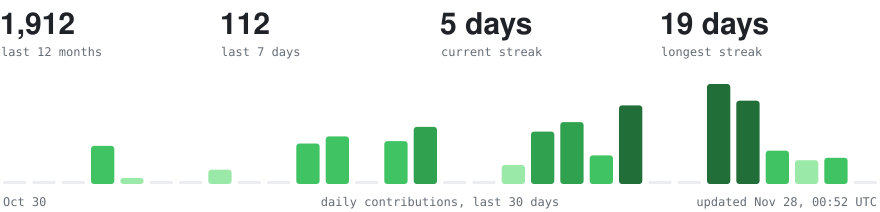

<picture>
  <source media="(prefers-color-scheme: dark)" srcset="./assets/header-dark.svg">
  
</picture>

Hi, I'm Berke. I work at [CarStudio AI](https://github.com/CarStudioAI), mostly on Java/Spring Boot services and the image and video processing behind the product. That code is private, so what you see here is mostly side projects.

**Side projects**

- [PortfolYO](https://portfolyo.tech): builds a portfolio site from your GitHub repos
- X-Zaptitle: macOS app that reads Xbox subtitles, translates them to Turkish and shows them on the TV

**Activity**

<picture>
  <source media="(prefers-color-scheme: dark)" srcset="https://raw.githubusercontent.com/berkezap/berkezap/output/activity-dark.svg">
  
</picture>

<picture>
  <source media="(prefers-color-scheme: dark)" srcset="https://raw.githubusercontent.com/berkezap/berkezap/output/github-snake-dark.svg">
  
</picture>
